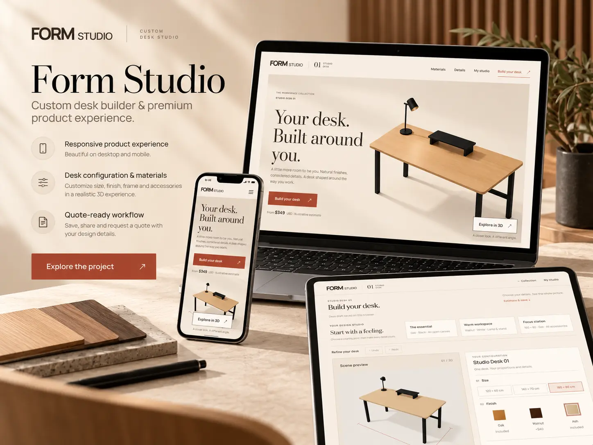

# Form Studio

A desk configurator for exploring proportions, materials and workspace details. Choose a starting setup, refine it in 3D, compare designs and keep the version you like.

[Live site](https://formstudioo.vercel.app/) · [Build a desk](https://formstudioo.vercel.app/configure) · [Portfolio](https://ataullah.vercel.app/)



## Features

- Parameterized 3D desk with three sizes, oak/walnut/ash finishes, two frame colours and optional accessories.
- Studio and room previews, dimension guides, lighting controls and a working desk lamp.
- Starting setups, Undo/Redo, design comparison and PNG export.
- Browser-local drafts, immutable public share links and Google sign-in for a personal workspace.
- Private demo quote requests, customer tracking and an owner inbox with status history.
- Lazy-loaded 3D, on-demand rendering, low-quality mode and a usable 2D fallback.

This is a portfolio product concept. Prices are illustrative; it does not sell furniture, create orders or send confirmation emails.

## Stack

Next.js App Router, React, TypeScript, Three.js, React Three Fiber, Drei, Prisma and PostgreSQL on Neon. Vitest covers product rules; Playwright covers the browser and database workflows.

## Local development

Use Node 22.x (22.13+), 24.x or 26+ and pnpm 11.21.0, matching `package.json`.

```sh
pnpm install --frozen-lockfile
cp .env.example .env
pnpm dev
```

Open [localhost:3000](http://localhost:3000). The configurator works without database credentials. Configure the server variables for sharing, accounts and quote requests; see [deployment](docs/deployment.md). Google fonts are downloaded at build time and self-hosted at runtime.

## Checks

```sh
pnpm check
```

For browser and database tests, see [testing](docs/testing.md). The database test harness creates and removes an isolated local PostgreSQL cluster.

## Project layout

```text
src/app/                    Pages and API routes
src/features/configurator/  Product controls, history and local drafts
src/features/scene/         Desk geometry, materials, camera and preview tools
src/features/quotes/        Demo enquiry form
src/server/                 Persistence, authentication and ownership checks
src/lib/                    Catalog, pricing and validation
prisma/                     Schema and migrations
public/assets/              Product images and wood textures
```

[Architecture](docs/architecture.md) · [Deployment](docs/deployment.md) · [Testing](docs/testing.md) · [Asset credits](docs/ASSETS.md)

By [Md Ataullah](https://ataullah.vercel.app/).
